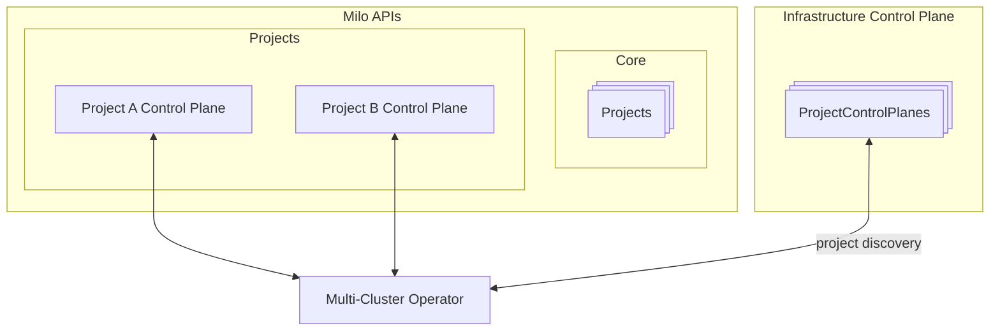
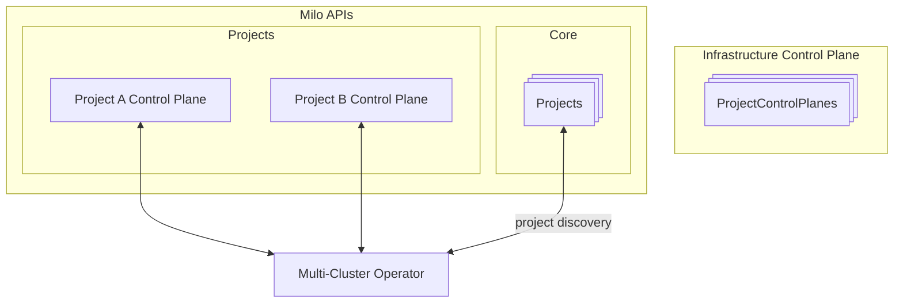

# Milo Provider Discovery Modes

The Milo provider supports two distinct discovery modes for connecting to
project clusters, each optimized for different deployment scenarios and
operational requirements.

## ProjectControlPlane

ProjectControlPlane mode uses internal service discovery within Milo's
infrastructure control plane to establish direct connections to project
clusters.

### How it Works

- Watches `ProjectControlPlane` resources in the infrastructure control plane
- Establishes connections using internal Kubernetes service addresses
- Connects directly to `milo-apiserver.project-{uid}.svc.cluster.local:6443`
- Requires the `ControlPlaneReady` condition to be true before engagement

### When to Use

- When the operator runs within the same Kubernetes cluster as the
  infrastructure control plane
- For internal operations and system-level controllers
- When network policies allow internal service-to-service communication
- Optimal performance due to direct internal networking

### Architecture



## Project

Project mode discovers clusters through the external Milo APIs and connects via
public endpoints.

### How it Works

- Watches `Project` resources through the core Milo APIs
- Constructs external API endpoints using the pattern:
  `/apis/resourcemanager.miloapis.com/v1alpha1/projects/{name}/control-plane`
- Requires the `Ready` condition to be true before engagement
- Uses external authentication and networking

### When to Use

- When the operator runs outside the infrastructure control plane
- For third-party integrations and external operators
- When connecting from remote locations or different clusters
- For customer-facing operators that need project isolation

### Architecture



## Configuration

The discovery mode is controlled by the `InternalServiceDiscovery` option:

```go
opts := milo.Options{
    InternalServiceDiscovery: true,  // Use ProjectControlPlane mode
    // InternalServiceDiscovery: false, // Use Project mode (default)
}
```

## Availability and replica engagement

The discovery controller runs on every replica, including followers of a
leader-electing manager. It owns only local cache/client engagement; native
service reconcilers retain their own leader-election behavior. Continue to wrap
the provider with `WithoutAutoStart` and call `EngageAlways` to start its provider
runnable on each replica. Both pieces are required: starting the runnable alone
does not make a leader-gated discovery controller reconcile on followers.

`Options.ProjectCacheSyncTimeout` bounds the initial per-project cache sync.
Zero selects the 30-second default; negative values are rejected. A timeout
cancels that unpublished project's cache, returns an error for rate-limited queue
retry, and frees the serial worker to process another project. Recovery retries
a new cache; a Ready-to-NotReady transition also cancels an engaged cache and a
later Ready transition reconnects it. This timeout never becomes the lifetime
of a successfully engaged cache.

The bound applies to `WaitForCacheSync`, not arbitrary custom cluster constructors,
REST mapper discovery, indexer callbacks, or multicluster `Engage` callbacks.
Consumers must bound their own network clients and watch initialization. One
serial worker can still accumulate delay across many unavailable projects; set
this timeout from measured project startup time and monitor engagement lag.
`HasSynced` means the initial set has been processed, including registration
failures. It is not proof that all projects are available or Apps admission is
installed.

`TestProviderUnavailableProjectAndReplicaRecovery` uses a real envtest API server,
two replicas competing for one leader lease, and a controlled project List/Watch
outage. It checks healthy-project engagement on both replicas, outage recovery,
NotReady disengagement and Ready reengagement. The test deliberately uses a
known REST mapping to isolate cache-sync behavior. It does not replace Milo
project-endpoint, Flux, ownership-admission or application-traffic end-to-end
validation.
